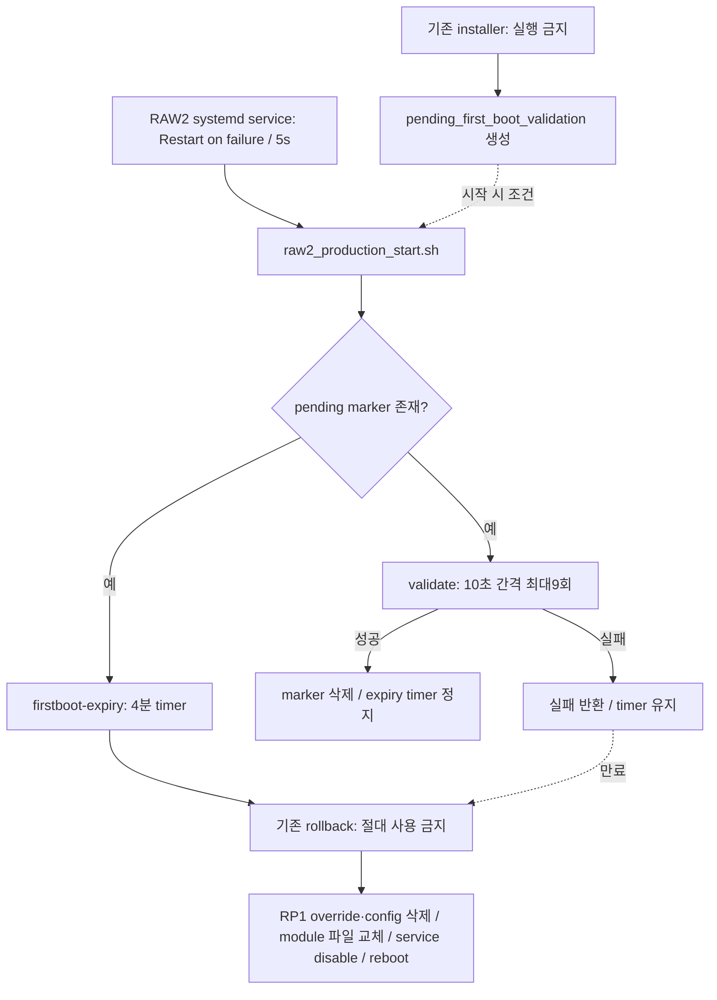

# 현재 RAW2 상태로의 별도 restore 설계 및 오프라인 검증

2026-10-21 23:14 KST. **Phase C BLOCKED. 현재 허용 범위는 파일/mock/dry-run과 읽기 전용 조사뿐이다.** 기존 `raw2_production_rollback.sh`는 수정·실행·예약·간접 호출하지 않는다. 새 restore는 작업 폴더의 별도 후보이며 실제 실행 backend는 의도적으로 없다.

## 1. 기존 호출 관계와 위험

실제 Pi의 파일 전체를 읽고 `/home/philip/dvs_raw2_production`, `/etc/systemd/system`, `/run/systemd/transient`의 관련 `.sh/.py/.service/.timer` 참조를 조사했다. 해시·참조 파일/행 번호는 `experiments/event-restore/evidence/rp5-readonly-inventory-20261021.json`에 있다. 이 범위 밖의 수동 외부 호출이나 모든 사용자 crontab의 부재까지 증명한 것은 아니다.

- start 56–58행은 **커널/모듈 확인 이전에** marker 조건으로 destructive rollback을 예약한다. 142–143행은 같은 조건으로 validate를 background 실행한다. start 자체도 setfile·RAW2 override·hand profile 쓰기, media graph reset, CSI 오류 파일 읽기, IPC/지표 파일 재생성, 서버/producer 시작을 수행한다. `systemctl start/restart`는 dry-run이 아니다.
- validate는 지표 및 일부 I2C 값을 확인하고 성공하면 marker와 timer를 정리한다. 실패해도 예약된 destructive action은 남는다. 이것도 순수한 검사 함수가 아니므로 실행하지 않았다.
- 서비스 `Restart=on-failure`, `RestartSec=5`, `TimeoutStopSec=45`, `KillMode=mixed`. 시작 실패는 start 재진입을 유발할 수 있다. installer는 marker를 생성하고 서비스 enable·reboot를 수행하므로 복원 도구로 재사용할 수 없다.
- 기존 rollback은 현재 모듈/설정을 유지하는 원복이 아닌 reference-B3 이전 환경 복귀다. `set +e`, 일부 오류 무시, 파일 삭제·서비스 disable·재부팅은 Event 실험의 실패 처리와 양립하지 않는다.
- 별도 `camera-root-watchdog.timer`는 현재 disabled/inactive지만 그 service의 script도 다른 legacy camera 서비스 restart 및 `systemctl reboot --force` 경로를 포함한다. **이것도 새 restore watchdog으로 재사용하지 않는다.**

## 2. 실제 관측한 baseline 후보

| 항목 | 읽기 전용 확인 | 검증 한계 |
|---|---|---|
| 서비스 | active/enabled, PID683775, NRestarts0, 2026-10-20 20:30:46 KST 시작 | 재시작/복구는 시험하지 않음 |
| pending marker | absent | 미래 재시작 동안 계속 absent라는 보장은 아님 |
| firstboot expiry timer/service | not-found/inactive, 트리거 없음 | 새로 예약하지 않았음 |
| camera root watchdog | timer disabled/inactive, service inactive | 수동 호출 방지·전체 외부 스케줄의 부재 증명은 아님 |
| system/user timers | system10개, user0개; expiry 없음 | 순간 관측이며 cgroup 생존 시험 아님 |
| RP1 module | `updates/rp1-cfe.ko`, SHA256 `0d09dbeaee5fda45bc3e24407254d19dd454c2f4fbb2a26c356b93bf47bfa3dd` | 파일 해시가 모든 소스/런타임 동작 증명은 아님 |
| 센서 module | `extra/s5krc1s_min.ko`, SHA256 `474d02b06165804310e91ee16dca70de691664f1b806783e3f4eda2dd6584153` | descriptor의 probe별 DT 복원은 미검증 |
| 런타임 수신 옵션 | DT42, link625000000, pack_bytes1, stride_zeroY | 센서 송신 DT의 새 실측이 아님 |
| 오류 계측 파라미터 | 현재 RP1 sysfs에는 diag_pack_bytes/diag_stride_zero/verbose_debug만 확인 | 조사에서 track_csi2_errors는 확인되지 않음; CSI error-free로 보고 금지 |
| media graph | `/dev/media0`, Y8_1X8/8192×128 → ch0, 전후 graph hash 일치 | graph 재설정/실제 DT0x31 수신 아님 |
| 정상 binary | producer SHA256 `5c2a88249aca8c3e3af0e0c3ec6ad772cad902ef215bc531a635f9c7af16776b` | 잘못된 설치 source 대신 실제 시작 binary 고정 |
| 레지스터 기록 | 저장된 startup 기록12행, mtime2026-10-20 20:30:47; 기존 startup assertion과 일치 | **현재 I2C 값 아님**. 이번 작업 I2C 접근0회 |

setfile/probe/profile, backup register record, config/modprobe, DTBO, systemd unit/drop-ins, server, Python interpreter, media/I2C 도구 존재와 해시를 확인했다. 세부 해시는 inventory 및 `rp5-readonly-extra-20261021.json`에 있다. 원본 setfile과 레지스터 값은 공개 Git에 복사하지 않았다. 현재 파일을 원상복원 가능한 private immutable bundle로 봉인한 단계까지 완료한 것은 아니다.

## 3. 새 restore 절차의 설계

후보 스크립트: `experiments/event-restore/restore_current_raw2.py`. dry-run은 관측 JSON을 읽어 계획·pin hash/파라미터 일치·차단 원인을 출력한다. exit2는 **계획 작성 성공과 별개로 hardware readiness는 BLOCKED**임을 뜻한다. mock은 OS temp 디렉터리의 sentinel/JSON만 변경한다. shell/systemd/I2C/module backend와 `--apply-live` 옵션은 없다.

향후 실기 구현 전에 검증해야 할 논리 순서는 다음과 같다. 현재는 이 순서를 fake 상태에만 적용했다.

1. exclusive lock, 현재 kernel/module/config/start/binary hash와 target identity, pending marker·모든 위험 timer·원래 service enable 상태를 확인한다. 누락·드리프트·timer 충돌 시 **아무 복원 작업 전 거부**한다. marker를 임의 삭제하거나 다른 timer를 정지해 검사를 통과시키지 않는다.
2. SSH session과 분리된 **새 전용 watchdog**을 준비한다. 기존 rollback과 camera watchdog 호출은 금지한다. 실제 cgroup/logind·timeout·취소 동작은 별도 검증 대상이다.
3. 소유가 확인된 실험 capture/Viewer만 종료하고 device close를 확인한다. broad pkill이나 다른 서비스를 정지하지 않는다.
4. 현재 파일을 유지한 채 승인된 최소 receiver runtime 변경만 되돌린다. 센서 driver의 DT는 probe 시 복사되므로 단순 sysfs 쓰기를 복원이라고 간주하지 않는다. 무재부팅 재probe/재바인드의 정확한 명령·media 수명·descriptor 확인은 아직 미검증이다. kernel/DT 설치·override 삭제·depmod는 계획에 없다.
5. snapshot으로 고정한 현재 RAW2 setfile→override→profile과 graph를 복원한다. 레지스터 값은 private baseline으로 관리하며 추측하거나 공개하지 않는다. 이 단계의 **실제 하드웨어 backend는 작성/실행하지 않았다**.
6. 현재 RAW2 프로세스·원래 systemd service 상태로 복귀한다. 기존 start를 그대로 재호출하는 구현은 marker/installer와의 race 및 destructive timer 경로를 해결하기 전 사용할 수 없다. mock의 `START_CURRENT_RAW2`는 문자열로 표현한 상태 전이일 뿐 기존 스크립트 호출이 아니다.
7. service active뿐 아니라 새 sequence의 연속 증가, DT/profile/graph, 실제 정상 영상, 오류 증가 없음, 웹/HDMI 및 데이터율 baseline을 여러 새 관측으로 비교한다. mock은 fresh sequence3회와 health/error/visual flags를 검사한다.
8. 완전히 검증된 뒤에만 **새 watchdog만** 해제하고 증거를 남긴다. 실패·시간초과 시 성공을 표시하지 않고 수동 개입 상태와 증거를 유지한다. 자동 reboot/disable/삭제/legacy rollback fallback은 없다.

실제 적용안은 service start 직전 marker 검사만으로 TOCTOU를 해결했다고 주장할 수 없다. 현재 start가 같은 exclusion lock을 공유하지 않으며, start가 끝날 때까지 외부 installer가 marker를 만들 가능성을 배제한 증거가 없다. 따라서 이 설계/mock 통과만으로 운영 재시작 권한이나 복구 보증을 부여하지 않는다.

## 4. 수행한 사전·실패 검증

- 기존 Phase B file/queue/decode/960×720 Viewer 및 Pi ASan 결과를 보존했다. 불필요하게 같은 샘플 suite를 다시 실행하지 않았다.
- 신규 adapter mock22건은 모든 OS entry point를 fake 함수로 치환했다. GREY 협상·capability/bus·buffer geometry·bytesused/index·partial setup·poll/DQBUF/QBUF/STREAMON 오류와 cleanup을 Pi ASan/UBSan에서 검증했다. 실제 device open0회.
- 엔진 `--device`는 이제 운영 active 여부와 관계없이 즉시 `PHASE_C_BLOCKED`를 반환한다. Pi에서 output 미생성/exit1을 확인했다.
- restore 초기21건 이후 hash/DT dry-run 검사3건을 보강한 최종 **24건이 로컬·Pi에서 PASS**했다. 원본 결과도 남겼다.
- 복구 실패(sensor profile), 서비스 start 실패, 정지된 sequence, 오류 증가, 영상 실패는 성공 판정을 거부하고 mock watchdog armed 상태/오류 증거를 남겼다. marker·timer 충돌 및 복원 중 race, kernel/file/enable-state drift, 미설정 watchdog, timeout injection, 중복 controller lock, idempotence, production root 거부를 포함한다.
- SSH 시뮬레이션은 수명이 짧은 로컬 mock client가 별도 session worker를 생성하고 종료한 뒤 worker가 fake 복원을 마치는지 확인했다. **실제 SSH를 끊거나 systemd cgroup 생존을 검증한 것이 아니다.** armed는 fake flag이며 살아 있는 실기 watchdog daemon을 뜻하지 않는다.
- dry-run은 observed module/start/binary/DTBO pin 및 파라미터가 일치해도 `production_ready=false`를 유지했다. 값이 누락·변조되면 추가 blocker를 표시한다. 읽기 전용 dry-run은 생산 상태를 변경하지 않았다.

코드·명령·개별 결과: restore README와 `experiments/event-restore/evidence/`, adapter/hard-hold 결과는 `experiments/event-engine/evidence/`. mock timeout은 오류 주입이며 실제 15분 운영 복구 timing proof가 아니다.

## 5. 현재 보존 상태와 실기 차단 조건

마지막 읽기 관측23:14:28 KST: PID683775/NRestarts0/active/enabled, sequence108187229→108189432(약2초), V4L2 dequeue/buffer/sequence-gap 오류 각각0, web 약58fps/HDMI 약60fps. 점검 대상 파일 metadata/hash·module parameters·media graph hash가 전후 동일했다. 이는 **운영 보존 증거**이며 모드 전환 후 복구 시험이 아니다.

Phase C는 아래가 해결될 때까지 BLOCKED다:

- 완전한 private 현재-state baseline 및 최신 live register/실제 정상 영상/CSI baseline.
- 승인된 Event setfile·geometry와 실제 descriptor DT 확인 방식.
- 무재부팅 runtime receiver 복원 및 sensor/media 초기화 backend의 검증.
- 기존 start/installer/firstboot 경로와의 race를 제거한 safe startup/서비스 소유권 설계.
- 새 전용 watchdog의 실제 detached/cgroup·발화·취소·실패 보고 검증.
- mock을 넘어서는 복구 검증을 안전하게 수행할 별도 조건과 운영 변경의 명시적 승인.

이번 작업의 운영 서비스 stop/restart·센서/I2C·module/DT·graph 변경·재부팅·실기 캡처는 모두0회다. 새 mock 절차 PASS로 HARD HOLD를 자동 해제하지 않는다.
